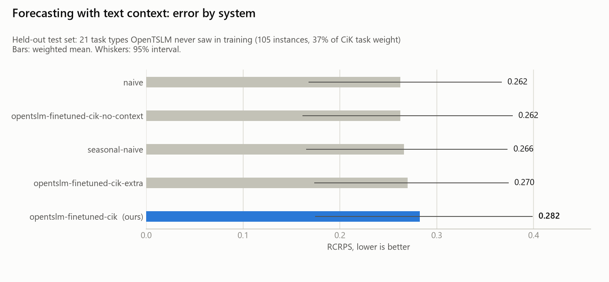
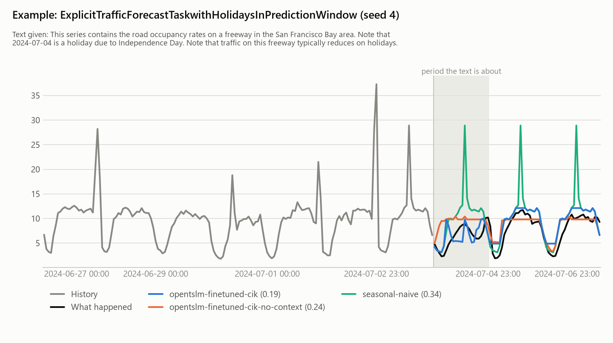
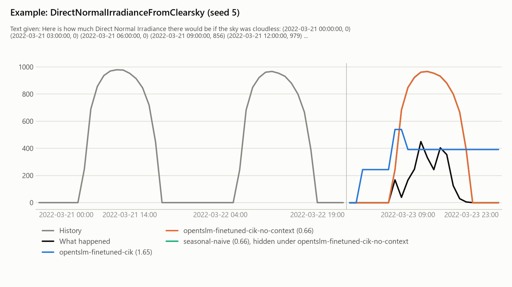

# Evaluation: results and what is left for the TimeNet Round 1 submission

Sun 22 Nov 2026. Owner: Dmitry. Code: `src/tslm_eval/`, `evaluation/`. Full results: [`evaluation/results/results.md`](../evaluation/results/results.md).
Due with the submission: Sun 22 Nov, 23:59 PST (Mon 08:59 CET).

## Why

The challenge asks teams to *"evaluate on held-out data and share your results"*. "Results and evaluation" is one of the five judging criteria, and the X and LinkedIn posts must include screenshots of metrics. This produces those results: one table, charts and a short summary, all from one command (`python -m tslm_eval report`).

## Where we are

Jonan's fine-tuned OpenTSLM model and its test outputs are in `opentslm-cik/` (model weights on Hugging Face: `jonanmathew/agentic-analyst-opentslm-cik`). The harness imports his saved test predictions and scores them with the benchmark's official metric, next to simple baselines. No GPU is needed for that.

| # | System | Status |
|---|---|---|
| 1 | Naive (repeat last value) | Done |
| 2 | Seasonal naive (repeat last day/week) | Done |
| 3 | Claude Opus 5.5, with context | Code ready; needs an Anthropic API key (issue #8), up to about $7 for the test set |
| 4 | Claude Opus 5.5, without context | Same key, up to about $7 |
| 5 | OpenTSLM before fine-tuning | Needs one GPU run (see "What is left") |
| 6 | **OpenTSLM fine-tuned on CiK (ours)** | **Done** (Jonan's Round 1 run) |
| 7 | Fine-tuned, trained and tested without the text | Done (Jonan's no-context run) |
| 8 | Fine-tuned with 534 extra generated training examples | Done (Jonan's Round 2 run) |

## Held-out data: decided

We use **Jonan's test split**: 21 task types (105 instances, 37% of CiK's task weight) whose series never appear in training or validation. He grouped together task types that share a series before splitting, so the test measures new kinds of problems, not memory. The id list is `evaluation/splits/test-opentslm-cik.txt`.

The earlier proposal (hold out the ATM, unemployment and sensor groups) is dropped: 50 of those 65 instances were in his training or validation data.

## Results (held-out test set, official RCRPS, lower is better)

| System | RCRPS | 95% interval |
|---|---|---|
| Naive | 0.262 | 0.168 to 0.367 |
| Fine-tuned, without the text | 0.262 | 0.161 to 0.378 |
| Seasonal naive | 0.266 | 0.165 to 0.373 |
| Fine-tuned + extra data | 0.270 | 0.174 to 0.374 |
| **Fine-tuned, with the text (ours)** | **0.282** | 0.174 to 0.399 |



How to read it:
- **Every system is within the others' uncertainty.** The instance-by-instance comparison in `results.md` confirms it: no difference is clear of zero.
- **One forecast moves the average.** On a solar task (`DirectNormalIrradianceFromClearsky/5`) the model scored 1.65 where seasonal naive scored 0.66. Without that one instance, ours, naive and seasonal naive all score 0.261 to 0.264.
- **The model learned the job.** 100% of its answers parse into the right number of values, and its answers carry an explanation.
- **The text helps where it describes the series' pattern.** On the sensor tasks the model scores 0.280, against 0.315 without the text and 0.320 for seasonal naive. On the holiday-traffic example below it follows the holiday dip that the seasonal baseline misses.
- **It often copies the seasonal-naive line it is given in the prompt.** Its forecast equals that line on 15 of 105 instances, and Jonan measured that it stays close to it on about 60% of tasks. On solar and traffic it does worse than seasonal naive.





### What we can and can't claim in the posts and the write-up

Supported by the numbers:
- A 1B model, fine-tuned for about an hour on one GPU, reads a series and a business note and returns a forecast with an explanation, in the right format every time.
- On held-out task types it is level with strong simple baselines, and better than them where the note describes a pattern in the series (sensor tasks, the holiday example).
- We report on task types the model never saw, scored with the benchmark's official metric, with intervals.

Not supported:
- "Beats the baseline". Jonan's README reports CRPS 0.242 against 0.251 for seasonal naive. That figure compares five sampled forecasts with a single baseline forecast, using an approximation of the metric. With the official metric, both scored as single forecasts, it does not beat the baseline. (The README is otherwise careful; this one line should change.)
- "The text improves the forecast" in general. Overall, the no-context model scores the same or slightly better.

## What is left, in order of value

1. **Claude rows (3 and 4).** These show what a frontier model gets from the same text, which gives our model a reference point. They need an Anthropic API key (issue #8). Then:
   ```
   python -m tslm_eval claude --split test --yes
   python -m tslm_eval claude --split test --no-context --yes
   python -m tslm_eval report
   ```
   Up to about $7 each for the 105 test instances (the command prints an estimate before spending).
2. **The "before fine-tuning" row (5).** One GPU run of Jonan's eval script with no checkpoint, about 20 to 30 minutes. On the Nebius VM where his code is set up:
   ```
   python eval_cik.py --ckpt none --out results/untuned --num_samples 5
   ```
   Copy `results/untuned/` into `opentslm-cik/results/untuned/`, then:
   ```
   python -m tslm_eval import-opentslm opentslm-cik/results/untuned --name opentslm-pretrained
   python -m tslm_eval report
   ```
3. **Delete the Nebius VM when done.** It bills by the hour while it exists, even when idle (Jonan's `NEBIUS.md`, step 7).

**Fallback:** if neither happens in time, submit with what is here. The test split, the official scores and the honest reading above already cover the judging criterion.

## Caveats to state in the write-up

- **Point forecasts.** The model's forecast is the median of its 3 to 5 samples (only the median was saved). The baselines and Claude also give one forecast. The scores therefore compare with each other, not with the CiK leaderboard, which uses 25 or more samples.
- **Small test set.** 21 task types, in 5 scenario families (electricity, solar, traffic, sensor, wind tunnel). Intervals are wide and are calculated by resampling whole tasks.
- **Seasonal naive in the prompt.** The model sees the seasonal-naive forecast as a reference line, which explains why it often copies it.
- **Contamination (Claude rows).** CiK was published in October 2024, so Claude may have seen it during training. That could flatter rows 3 and 4.
- **Settings recorded.** Each run's model, checkpoint, sampling, and for Claude the effort level, prompt version and API cost, are printed in `results.md`. Claude runs use one named model with server-side fallback off.

## Metric, in plain words

RCRPS is CiK's official score:
- **The scaled forecast error.** The region the text is about gets half the weight.
- **A penalty for breaking stated constraints,** such as "values cannot be negative".
- **Lower is better, and 0 is perfect.** Each instance is capped at 5, which is also the score of a failed or unreadable output.
- **Instances are combined with CiK's task weights,** so families of near-identical tasks don't dominate.

`src/tslm_eval/metric.py` is tested against a transcription of the official code.
