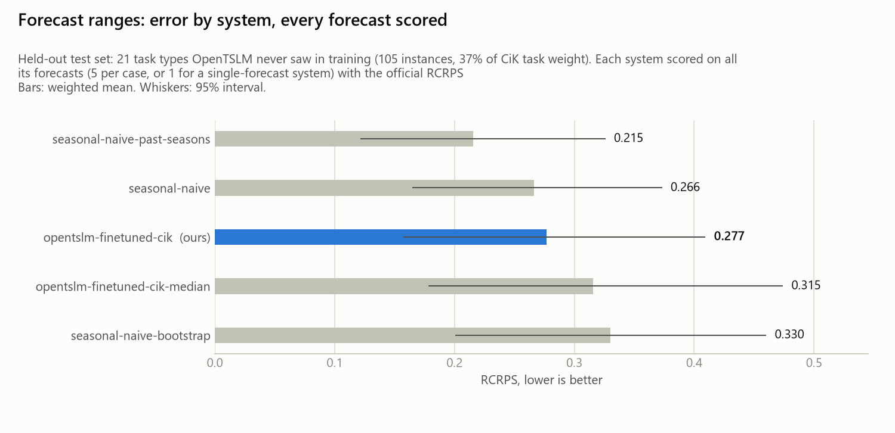

# Evaluation: results and what is left for the TimeNet Round 1 submission

Sun 22 Nov 2026. Owner: Dmitry. Code: `src/tslm_eval/`, `evaluation/`. Full results: [`evaluation/results/results.md`](../evaluation/results/results.md) (forecast error) and [`evaluation/results/uncertainty.md`](../evaluation/results/uncertainty.md) (forecast ranges).
Due with the submission: Sun 22 Nov, 23:59 PST (Mon 08:59 CET).

## Why

The challenge asks teams to *"evaluate on held-out data and share your results"*. "Results and evaluation" is one of the five judging criteria, and the X and LinkedIn posts must include screenshots of metrics. This produces those results: one table, charts and a short summary, all from one command (`python -m tslm_eval report`).

## Where we are

Jonan's fine-tuned OpenTSLM model and its test outputs are in `opentslm-cik/` (model weights on Hugging Face: `jonanmathew/agentic-analyst-opentslm-cik`). The harness imports his saved test predictions and scores them with the benchmark's official metric, next to simple baselines. No GPU is needed for that. The two runs that did need a GPU, the model before fine-tuning and a rerun of the fine-tuned model that saves every sample, ran on a Nebius L40S on 22 Nov (raw outputs in `opentslm-cik/results/untuned/` and `opentslm-cik/results/full-samples/`).

| # | System | Status |
|---|---|---|
| 1 | Naive (repeat last value) | Done |
| 2 | Seasonal naive (repeat last day/week) | Done |
| 3 | Claude Opus 5.5, with context | Dropped for Round 1 (no API key in time). The code is ready (`python -m tslm_eval claude`) |
| 4 | Claude Opus 5.5, without context | Dropped for Round 1, as above |
| 5 | OpenTSLM before fine-tuning | Done (run on Nebius, 22 Nov) |
| 6 | **OpenTSLM fine-tuned on CiK (ours)** | **Done** (Jonan's Round 1 run, and a rerun that saves every sample, for the uncertainty comparison) |
| 7 | Fine-tuned, trained and tested without the text | Done (Jonan's no-context run) |
| 8 | Fine-tuned with 534 extra generated training examples | Done (Jonan's Round 2 run) |
| 9 | Seasonal naive with a range: 5 forecasts, each repeating one of the last 5 days or weeks | Done (uncertainty comparison only) |
| 10 | Seasonal naive with a range: its forecast plus 5 runs of its own past errors | Done (uncertainty comparison only) |

## Held-out data: decided

We use **Jonan's test split**: 21 task types (105 instances, 37% of CiK's task weight) whose series never appear in training or validation. He grouped together task types that share a series before splitting, so the test measures new kinds of problems, not memory. The id list is `evaluation/splits/test-opentslm-cik.txt`.

The earlier proposal (hold out the ATM, unemployment and sensor groups) is dropped: 50 of those 65 instances were in his training or validation data.

## In short

- **Fine-tuning works.** Before fine-tuning, OpenTSLM can't produce a forecast: 4% of its answers are readable and it scores 4.450. After fine-tuning, 100% are readable and it scores 0.282. On the 17 instances where the model gave a forecast before fine-tuning too, the error drops from 1.54 to 0.23, level with seasonal naive (0.24).
- **It is level with strong simple baselines, not better.** That is true of single forecasts and of forecast ranges, where it is worse than one baseline.
- **Its best cases are notes saying past data was bad** (a sensor glitch, maintenance). It beats seasonal naive there in Jonan's run. This is an early signal, not yet a result (see "What we can and can't claim").

## Results (held-out test set, official RCRPS, lower is better)

| System | RCRPS | 95% interval |
|---|---|---|
| Naive | 0.262 | 0.168 to 0.367 |
| Fine-tuned, without the text | 0.262 | 0.161 to 0.378 |
| Seasonal naive | 0.266 | 0.165 to 0.373 |
| Fine-tuned + extra data | 0.270 | 0.174 to 0.374 |
| **Fine-tuned, with the text (ours)** | **0.282** | 0.174 to 0.399 |
| Before fine-tuning | 4.450 | 4.182 to 4.703 |

How to read it:
- **Fine-tuning is what makes the model usable.** Before fine-tuning, OpenTSLM writes captions about the series (it was pretrained on describing M4 series), not the numbered forecast it is asked for. Only 4% of its sampled answers could be read as a forecast, and on 88 of 105 instances none of its 5 samples could. A failed output scores 5, the cap, so it averages 4.450. After fine-tuning, every answer is a readable forecast and the score is 0.282. The gain is not only format: on the 17 instances where the model gave a readable forecast before fine-tuning, it scored 1.543 then and 0.233 after (seasonal naive: 0.239). The chart leaves this row out so the other bars stay readable.
- **Every fine-tuned model and baseline is within the others' uncertainty.** The instance-by-instance comparison in `results.md` confirms it: no difference between them is clear of zero.
- **One forecast moves the average.** On a solar task (`DirectNormalIrradianceFromClearsky/5`) the model scored 1.65 where seasonal naive scored 0.66. Without that one instance, ours, naive and seasonal naive all score 0.261 to 0.264.
- **The model learned the format.** 100% of its answers parse into the right number of values, and its answers carry an explanation. This is a format check, not a quality check.
- **Its best tasks are the ones where the note says past data was bad.** On the sensor tasks (a glitch, maintenance) the model scores 0.280, against 0.320 for seasonal naive, a paired difference of -0.040 (interval -0.066 to -0.002). On the holiday-traffic example below it follows the holiday dip that the seasonal baseline misses. It does worst on solar, where it is behind seasonal naive by 0.067 (+0.005 to +0.144).
- **It often copies the seasonal-naive line it is given in the prompt.** Its forecast equals that line on 15 of 105 instances, and Jonan measured that it stays close to it on about 60% of tasks. On solar and traffic it does worse than seasonal naive.

## Uncertainty: do the model's forecast ranges beat a baseline's?

The showcase PDF's headline says the model "beats [the baseline] on uncertainty": CRPS 0.242 against 0.251. That number scored 5 sampled forecasts from the model against a single forecast from the baseline, using an approximation of the metric. A single forecast has no spread, so CRPS scores it as its plain error, and any spread in the model's samples lowers the model's score: the comparison favours the model before either forecasts anything. Only the median was saved, so it could not be re-checked.

To test it properly we reran the same checkpoint (`best_model_full.pt` from Hugging Face), saving all 5 samples, and compared it with baselines that also give 5 forecasts, built from the history only. In Jonan's approximate metric the rerun gives 0.241, so it repeats his run faithfully. Every system is then scored on all its forecasts with the official RCRPS. The verdict rule was fixed before the run: claim better uncertainty only if ours beats every baseline with a range, with each instance-by-instance interval clear of 0.

| System | Forecasts per case | RCRPS | 95% interval | Truth inside the range (expected if well calibrated) |
|---|---|---|---|---|
| Seasonal naive, each of the last 5 days or weeks | 5 | 0.215 | 0.122 to 0.326 | 50% (62%) |
| Seasonal naive | 1 | 0.266 | 0.165 to 0.373 | n/a |
| **Fine-tuned, with the text (ours)** | 5 | **0.277** | 0.157 to 0.409 | 31% (67%) |
| Ours, median of the same 5 | 1 | 0.315 | 0.178 to 0.474 | n/a |
| Seasonal naive plus 5 runs of its past errors | 5 | 0.330 | 0.201 to 0.460 | 45% (67%) |

"Truth inside the range" is the share of forecast steps where the true value lies between the lowest and highest of the forecasts. For 5 well-calibrated forecasts it is about 67%. It is 62% for the first baseline because some series have fewer than 5 days or weeks of history, so it gives fewer forecasts.

**Verdict: worse on uncertainty.**
- **A simple baseline with a range beats the model's range.** Repeating each of the last 5 days or weeks scores 0.061 better on average (interval +0.016 to +0.135), and better on 88% of instances.
- **The model's ranges are too narrow.** The truth falls inside its 5 forecasts on 31% of steps, where well-calibrated forecasts would cover about 67%. The model is overconfident.
- **Its samples do carry some useful spread.** Scored as a range, they beat their own median (by 0.039, interval -0.078 to -0.015) and the bootstrap baseline (by 0.053, interval -0.110 to -0.004).

Full tables: [`evaluation/results/uncertainty.md`](../evaluation/results/uncertainty.md).

### What we can and can't claim in the posts and the write-up

Supported by the numbers:
- A 1B model, fine-tuned for about an hour on one GPU, reads a series and a business note and returns a forecast with an explanation, in the right format every time.
- **Fine-tuning works.** It turns OpenTSLM from a model that can't produce a forecast (4% readable, 4.450) into one level with strong simple baselines (100% readable, 0.282). Where both versions gave a forecast, the error drops from 1.54 to 0.23.
- On held-out task types it is level with strong simple baselines.

Promising, to be stated as an early signal:
- **It beats the baseline where the note says past data was bad.** Sensor tasks: 0.280 against 0.320 for seasonal naive, interval just clear of 0 in Jonan's run, plus the glitch and maintenance examples in the PDF. Three cautions:
  - It is 3 task types (15 instances), and this group stood out after seeing the results.
  - In the rerun of the same checkpoint, the edge shrinks to 0.018 and the interval includes 0.
  - Against the model trained without the note, the sensor difference is not clear (interval -0.121 to +0.117), so it is not established that the note causes it.
- The claim must be defined by the kind of note. "Better where the baseline did badly" would be biased: selecting instances by the baseline's own large errors makes any other method look better by chance.
- We report on task types the model never saw, scored with the benchmark's official metric, with intervals, and we tested our own uncertainty claim with a rule fixed in advance.

Not supported:
- "Beats the baseline". With the official metric, both scored as single forecasts, it does not (0.282 against 0.266, interval includes 0). Jonan's README line reporting CRPS 0.242 against 0.251 should change for the same reason as the PDF.
- "Beats it on uncertainty". Tested and wrong: a simple baseline that also gives 5 forecasts beats the model's range, and the model's ranges are too narrow.
- "The text improves the forecast" in general. Overall, the no-context model scores the same or slightly better.

### Corrections for the showcase PDF (Jonan)

1. **Headline,** "Ties a strong baseline on error, beats it on uncertainty". Drop the second half. Suggestion: "Fine-tuning turns a 1B time-series model into a forecaster that matches strong baselines on unseen tasks".
2. **Tile "0.242, Range quality (CRPS), vs 0.251 for the baseline".** Replace it with the official score: "0.282, CiK's official score (RCRPS), vs 0.266 for seasonal naive. Level within the intervals."
3. **Tile "100% of answers were valid forecasts".** The number is right, but it is a format check. Suggestion: "100% of answers were readable forecasts in the right format, against 4% before fine-tuning".
4. **Tile "105 held-out test tasks".** These are 105 test cases from 21 task types. Suggestion: "105 test cases from 21 task types the model never saw in training".
5. **Results table and its note.** Replace the "Range quality (CRPS)" column with the official RCRPS (seasonal naive 0.266, ours 0.282, ours without the note 0.262), and drop "Our CRPS is an approximation" in favour of "scored with CiK's official metric".
6. **"Next" section,** "range quality improved (CRPS 0.236, down from 0.242)". This uses the same approximation. On the official metric the extra-data model scores 0.270 against 0.282, within the intervals.

## What is left

1. **Jonan: apply the PDF corrections** above before the posts go out.
2. **Delete the Nebius VMs when done** (`brown-carp-instance-1`, used for the runs here, and `yellow-mosquito-instance-2`). They bill by the hour while they exist, even when idle (Jonan's `NEBIUS.md`, step 7).
3. **For Round 2:**
   - The Claude rows (3 and 4), as a reference point for what a frontier model gets from the same text. The code is ready (`python -m tslm_eval claude --split test --yes`, up to about $7 per row; it prints an estimate before spending).
   - Wider, better-calibrated ranges: a higher sampling temperature, or 25 samples per case as on the CiK leaderboard, checked against the same range baselines with `python -m tslm_eval report-uncertainty`.

## Caveats to state in the write-up

- **Point forecasts in the main table.** There the model's forecast is the median of its 3 to 5 samples, and each baseline gives one forecast. The uncertainty comparison scores 5 forecasts per system. Neither compares directly with the CiK leaderboard, which scores 25 or more samples.
- **Run-to-run variation.** The same checkpoint, sampled again, gives a median that scores 0.315 instead of 0.282 (paired interval 0.000 to +0.096). Most of the gap comes from three solar instances (`DirectNormalIrradianceFromClearsky` seeds 1, 3 and 5). One sampling run moves the score about as much as the gaps between systems in the main table, which is another reason not to rank them.
- **Small test set.** 21 task types, in 5 scenario families (electricity, solar, traffic, sensor, wind tunnel). Intervals are wide and are calculated by resampling whole tasks.
- **Seasonal naive in the prompt.** The model sees the seasonal-naive forecast as a reference line, which explains why it often copies it.
- **Settings recorded.** Each run's model, checkpoint, sampling and source folder are printed in `results.md` and `uncertainty.md`.

## Metric, in plain words

RCRPS is CiK's official score:
- **The scaled forecast error.** The region the text is about gets half the weight.
- **A penalty for breaking stated constraints,** such as "values cannot be negative".
- **Lower is better, and 0 is perfect.** Each instance is capped at 5, which is also the score of a failed or unreadable output.
- **Instances are combined with CiK's task weights,** so families of near-identical tasks don't dominate.

`src/tslm_eval/metric.py` is tested against a transcription of the official code.
