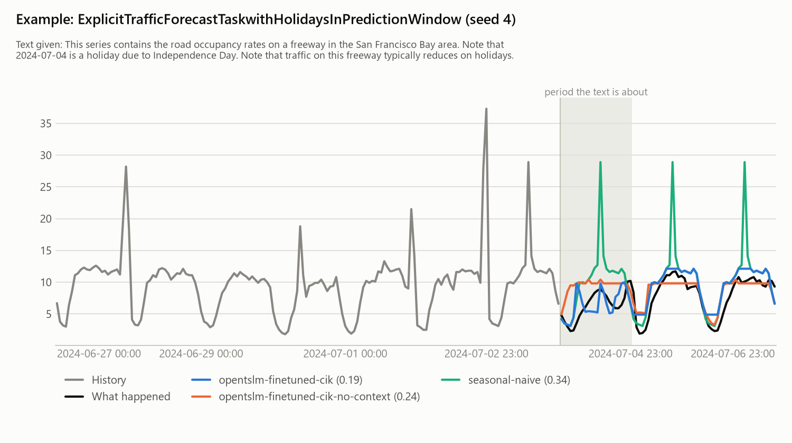
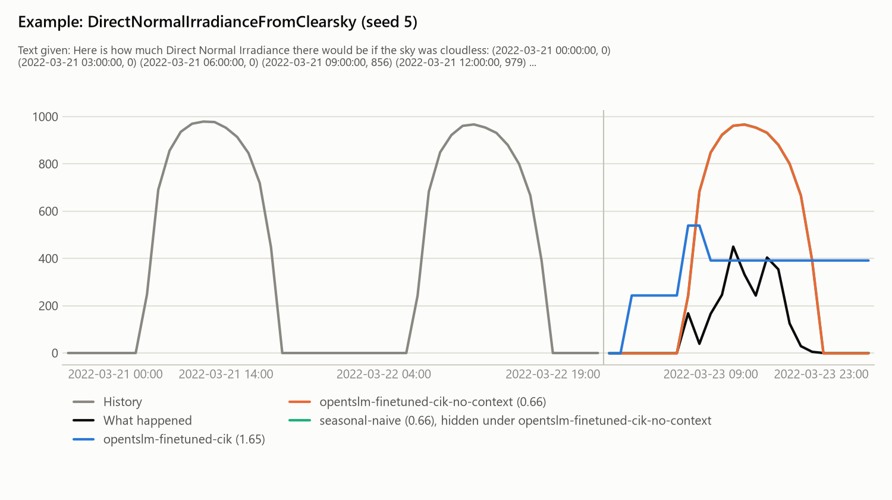

# Results: Context is Key forecasting

Generated 2026-11-22 by `python -m tslm_eval report`. Metric: RCRPS, the benchmark's own score (scaled error, half-weighted on the region the text is about, plus a penalty for breaking stated constraints; capped at 5, which is also the score of a failed output). Weighted mean over instances with CiK's task weights; interval from resampling whole tasks. All systems give point forecasts, so scores compare with each other, not with the published CiK leaderboard (which samples 25+ forecasts).

## Held-out test set: 21 task types OpenTSLM never saw in training (105 instances, 37% of CiK task weight)

| System | RCRPS (lower is better) | 95% interval | Valid outputs | Beats seasonal-naive on | Instances (tasks) |
|---|---|---|---|---|---|
| naive | 0.262 | 0.168 to 0.367 | 100% | 17% | 105 (21) |
| opentslm-finetuned-cik-no-context | 0.262 | 0.161 to 0.378 | 100% | 33% | 105 (21) |
| seasonal-naive | 0.266 | 0.165 to 0.373 | 100% |  | 105 (21) |
| opentslm-finetuned-cik-extra | 0.270 | 0.174 to 0.374 | 100% | 42% | 105 (21) |
| opentslm-finetuned-cik | 0.282 | 0.174 to 0.399 | 100% | 36% | 105 (21) |

### Our model against each system, instance by instance

Both systems are scored on the same instances, so this is a sharper test than comparing the two means above. A negative difference means ours is better. If the interval includes 0, this test set cannot tell the two apart.

| opentslm-finetuned-cik compared with | Difference in RCRPS (ours minus other) | 95% interval | Ours lower (better) | Ours higher |
|---|---|---|---|---|
| naive | +0.020 | -0.024 to +0.091 | 69% | 31% |
| opentslm-finetuned-cik-no-context | +0.020 | -0.019 to +0.084 | 48% | 32% |
| seasonal-naive | +0.016 | -0.004 to +0.051 | 36% | 64% |
| opentslm-finetuned-cik-extra | +0.012 | -0.013 to +0.054 | 44% | 41% |

## All 355 instances

Zero-shot systems (baselines, Claude, pretrained OpenTSLM) never trained on CiK, so all 355 are unseen for them. A model fine-tuned on CiK must be read on the held-out set only.

| System | RCRPS (lower is better) | 95% interval | Valid outputs | Beats seasonal-naive on | Instances (tasks) |
|---|---|---|---|---|---|
| naive | 0.332 | 0.264 to 0.410 | 100% | 14% | 355 (71) |
| seasonal-naive | 0.352 | 0.254 to 0.485 | 100% |  | 355 (71) |

Not in this table, because they were run on the test set only: opentslm-finetuned-cik-extra, opentslm-finetuned-cik-no-context, opentslm-finetuned-cik.

## By scenario group (held-out test set)

| Scenario group | naive | opentslm-finetuned-cik-extra | opentslm-finetuned-cik-no-context | opentslm-finetuned-cik | seasonal-naive |
|---|---|---|---|---|---|
| electricity | 0.092 | 0.090 | 0.090 | 0.088 | 0.087 |
| sensor | 0.408 | 0.323 | 0.315 | 0.280 | 0.320 |
| solar | 0.314 | 0.358 | 0.310 | 0.421 | 0.353 |
| traffic | 0.208 | 0.247 | 0.236 | 0.255 | 0.241 |
| wind-tunnel | 0.616 | 0.616 | 0.669 | 0.616 | 0.616 |

## Run settings

- `opentslm-finetuned-cik-extra`: OpenTSLM `OpenTSLM/llama-3.2-1b-m4-sp` fine-tuned (checkpoint `results/extra/best_model.pt`), context given, median of 3 samples at temperature 0.7; trained 1 epoch (validation loss 1.126), with extra generated training examples. Imported from `opentslm-cik/results/extra`.
- `opentslm-finetuned-cik-no-context`: OpenTSLM `OpenTSLM/llama-3.2-1b-m4-sp` fine-tuned (checkpoint `results/nocontext/best_model.pt`), context withheld in training and test, median of 5 samples at temperature 0.7; best of 3 epochs was epoch 1 (validation loss 1.253). Imported from `opentslm-cik/results/nocontext`.
- `opentslm-finetuned-cik`: OpenTSLM `OpenTSLM/llama-3.2-1b-m4-sp` fine-tuned (checkpoint `results/full/best_model.pt`), context given, median of 5 samples at temperature 0.7; best of 3 epochs was epoch 1 (validation loss 1.093). Imported from `opentslm-cik/results/full`.

## Examples

Chosen by hand (`--example`) to illustrate. The tables above are the result. The number after each system is its RCRPS on that instance.

