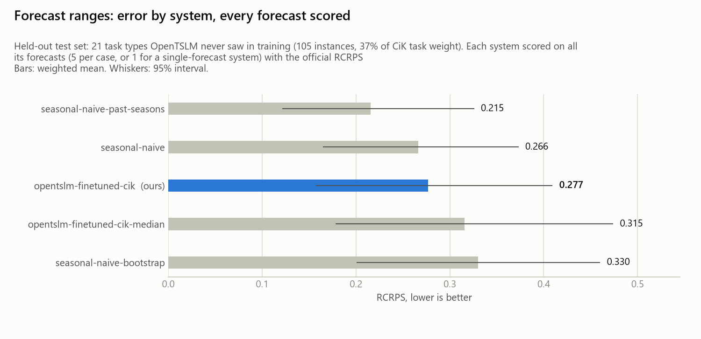

# Uncertainty: do the model's forecast ranges beat a baseline's?

Generated 2026-11-22 by `python -m tslm_eval report-uncertainty`. Held-out test set: 21 task types OpenTSLM never saw in training (105 instances, 37% of CiK task weight).

Every system is scored on its whole set of forecasts with the official RCRPS (CRPS over the samples, half-weighted on the region the text is about, plus the constraint penalty). CRPS rewards a sensible spread, so a single forecast is at a disadvantage against any set of samples. The fair comparison is therefore with baselines that also give several forecasts, built from the history only:

- `seasonal-naive-past-seasons`: each forecast repeats one of the last 5 days or weeks (one of the last 5 values when the series has no season).
- `seasonal-naive-bootstrap`: the seasonal-naive forecast plus 5 runs of the errors that rule made in the history (a random walk of past one-step changes when there is no season).

"Truth inside the range" is the share of forecast steps where the true value lies between the lowest and highest forecast. For 5 well-calibrated forecasts it should be about 67%: lower means the ranges are too narrow (overconfident), higher means too wide.

| System | Forecasts per case | RCRPS (lower is better) | 95% interval | Truth inside the range (expected if well calibrated) | Valid outputs |
|---|---|---|---|---|---|
| seasonal-naive-past-seasons | 5 | 0.215 | 0.122 to 0.326 | 50% (62%) | 100% |
| seasonal-naive | 1 | 0.266 | 0.165 to 0.373 | n/a (single forecast) | 100% |
| opentslm-finetuned-cik | 5 | 0.277 | 0.157 to 0.409 | 31% (67%) | 100% |
| opentslm-finetuned-cik-median | 1 | 0.315 | 0.178 to 0.474 | n/a (single forecast) | 100% |
| seasonal-naive-bootstrap | 5 | 0.330 | 0.201 to 0.460 | 45% (67%) | 100% |

### opentslm-finetuned-cik against each system, instance by instance

A negative difference means ours is better. If the interval includes 0, this test set cannot tell the two apart.

| opentslm-finetuned-cik compared with | Difference in RCRPS (ours minus other) | 95% interval | Ours lower (better) | Ours higher |
|---|---|---|---|---|
| seasonal-naive-past-seasons | +0.061 | +0.016 to +0.135 | 12% | 88% |
| seasonal-naive | +0.011 | -0.028 to +0.069 | 59% | 41% |
| opentslm-finetuned-cik-median | -0.039 | -0.078 to -0.015 | 81% | 1% |
| seasonal-naive-bootstrap | -0.053 | -0.110 to -0.004 | 47% | 53% |

### Verdict

Rule fixed before the runs: claim better uncertainty only if ours beats every baseline with a range and each interval is clear of 0.

**Worse on uncertainty: at least one baseline with a range beats ours, with an interval clear of 0.**

## Run settings

- `opentslm-finetuned-cik-median`: OpenTSLM `OpenTSLM/llama-3.2-1b-m4-sp` fine-tuned (checkpoint `/home/analyst/ckpt/best_model_full.pt`), context given, median of 5 samples (readable ones only) at temperature 0.7. Imported from `opentslm-cik/results/full-samples`.
- `opentslm-finetuned-cik`: OpenTSLM `OpenTSLM/llama-3.2-1b-m4-sp` fine-tuned (checkpoint `/home/analyst/ckpt/best_model_full.pt`), context given, every readable sample of 5 at temperature 0.7. Imported from `opentslm-cik/results/full-samples`.
