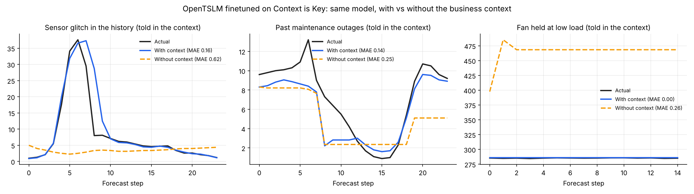

# OpenTSLM fine-tuned on Context is Key

Team **Agentic Analyst**, TimeNet hackathon, Round 1.

A small time-series language model that reads a numeric series **plus a short business note** ("a heat wave
starts tomorrow", "the sensor was being serviced from 10:00 to 12:00") and writes back:

1. a forecast, one numbered line per future step, and
2. a two or three sentence business explanation of that forecast.

The goal is to shorten the slow part of an analyst's job: going from raw KPI data to a forecast someone can
read and question.

- **Model weights:** [huggingface.co/jonanmathew/agentic-analyst-opentslm-cik](https://huggingface.co/jonanmathew/agentic-analyst-opentslm-cik)
- **Data:** Context is Key ([ServiceNow/context-is-key](https://huggingface.co/datasets/ServiceNow/context-is-key)),
  loaded through TimeNet with our connector ([OpenTSLM/TimeNet PR 788](https://github.com/OpenTSLM/TimeNet/pull/788))
- **Base model:** [`OpenTSLM/llama-3.2-1b-m4-sp`](https://huggingface.co/OpenTSLM/llama-3.2-1b-m4-sp)
  (OpenTSLM-SP on Llama 3.2 1B, pretrained on M4 captioning)



## How it was trained

| | |
| --- | --- |
| Method | LoRA (rank 16, dropout 0.05) on the LLM, plus the OpenTSLM time-series encoder and projector |
| Data | 355 CiK instances (71 task types x 5 seeds). Split **by groups of task types that share a series**, so no test series is ever seen in training: 215 train / 35 validation / 105 test |
| Targets | The true future values plus a short explanation per instance (`cik_rationales.jsonl`, written from each instance's context and true future) |
| Prompt | History, the CiK background/scenario/constraints text, and a seasonal-naive forecast as a reference line |
| Schedule | Up to 4 epochs, early stopping (patience 2), lr 1e-4 encoder / 5e-5 projector / 5e-5 LoRA. Best checkpoint was epoch 1 (validation loss 1.093) |
| Hardware | 1x NVIDIA L40S on Nebius, about 1 hour for the main run plus the no-context comparison |

## Results (105 held-out test instances, 21 unseen task types)

Lower is better. "Baseline" is seasonal naive: repeat the last season.

| Run | MAE | CRPS | Outputs parsed |
| --- | --- | --- | --- |
| **Round 1: with business note** (`best_model_full.pt`) | 0.225 | **0.242** | 100% |
| Same model trained and tested without the note | 0.228 | 0.227 | 100% |
| Round 2: with note + 534 extra generated examples (`best_model_extra.pt`) | 0.230 | 0.236 | 99.7% |
| Seasonal-naive baseline | **0.221** | 0.251 | n/a |

MAE and CRPS are scaled like CiK's RCRPS (region of interest weighted to half). For numbers comparable to the
CiK paper, run CiK's official `compute_rcrps_with_hf_dataset.py` on the same instances. Full per-instance
outputs, including every explanation, are in `results/*/test_predictions.jsonl`.

What this shows:

- The model reliably learned the output format (100% of answers parse into the right number of values) and
  beats the baseline on CRPS, meaning its spread of forecasts is better calibrated.
- On point accuracy (MAE) it is level with the baseline, not ahead of it.
- Where the note describes something visible in the history, it helps a lot. On the sensor-glitch and
  maintenance tasks the with-note model's error was 0.113, against 0.245 without the note (baseline 0.118).
  See `showcase/1_sensor_glitch.png` and `showcase/2_maintenance.png`.
- The Round 2 run with more varied training data was a near tie: slightly better CRPS, slightly worse MAE, and it
  beat the baseline on more tasks (43 of 105 versus 32).

## Honest caveats

- **It often copies the baseline.** The seasonal-naive forecast is in the prompt, and on about 60% of test tasks
  the model's forecast stays within 0.2 standard deviations of it. Against the baseline per task: 9 better,
  61 within 5%, 35 worse.
- **It misses events that change the future but not the past.** In the heat-wave electricity example the note
  says demand will rise, but the model's forecast is the baseline with no adjustment
  (`showcase/5_heatwave_miss.png`).
- **Explanations can invent numbers.** They read fluently, but figures and directions in them are not checked
  against the forecast. Treat them as a draft, not a fact.
- **Small data.** 215 training instances, and almost half are Montreal fire-incident tasks. The model starts
  memorizing after one epoch.

## Repository layout

| Path | What it is |
| --- | --- |
| `cik_core.py` | Loads CiK (TimeNet or Hugging Face), builds prompt/answer pairs, does the grouped split, parses output, scores forecasts. No GPU needed. |
| `CiKQADataset.py` | OpenTSLM dataset class (same pattern as OpenTSLM's `M4QADataset`). |
| `cik_extra.py` | Extra generated training examples used for Round 2. |
| `cik_rationales.jsonl`, `build_rationales.py`, `make_rationales.py` | The explanation the model learns for each instance, and the scripts that write them. |
| `train_cik.py`, `eval_cik.py` | Train and evaluate. |
| `run_nuvolos.sh` | One script for any GPU machine: `setup`, `smoke`, `full`, `pack`. |
| `TRAINING.md`, `NEBIUS.md`, `NUVOLOS.md`, `colab_smoke_test.ipynb` | Step-by-step training guides. |
| `demo/` | A local web demo (forecast chart plus explanation, replay mode, and a same-size comparison with plain Llama 3.2 1B and Gemma 3 1B). See `demo/DEMO.md`. |
| `results/` | Metrics, training logs and all test predictions for the three runs above. |
| `showcase/` | Charts used in our submission. |
| `tests/` | Unit tests for `cik_core.py` (`pytest tests`). |

## Train and evaluate

Full instructions are in [`TRAINING.md`](TRAINING.md) (any GPU machine) and [`NEBIUS.md`](NEBIUS.md). In short,
on a Linux machine with an NVIDIA GPU and Llama 3.2 access on Hugging Face:

```bash
bash run_nuvolos.sh setup    # installs OpenTSLM + TimeNet with the CiK connector, logs in to Hugging Face
bash run_nuvolos.sh smoke    # a few minutes, checks everything runs
bash run_nuvolos.sh full     # main model + no-context comparison, about 1 hour on an L40S
```

Or step by step, from inside an OpenTSLM checkout with these files copied in (see `TRAINING.md` step 2):

```bash
python train_cik.py --out results/full
python train_cik.py --out results/nocontext --no_context
python eval_cik.py --ckpt results/full/best_model.pt --out results/full
python eval_cik.py --ckpt results/nocontext/best_model.pt --no_context --out results/nocontext
```

## Use the trained model

The checkpoint holds only what training changed (encoder, projector, LoRA weights; about 55 MB). The Llama base
model is downloaded separately, so you need Llama 3.2 access on Hugging Face.

```bash
pip install -U "huggingface_hub[cli]"
huggingface-cli download jonanmathew/agentic-analyst-opentslm-cik best_model_full.pt --local-dir demo/checkpoints
```

Evaluate it, from an OpenTSLM checkout set up as in `TRAINING.md`:

```bash
python eval_cik.py --ckpt demo/checkpoints/best_model_full.pt --out results/check
```

Or load it in Python:

```python
from train_cik import load_model   # same loader training used

# Loads OpenTSLM/llama-3.2-1b-m4-sp and switches LoRA on (rank 16), then adds our fine-tuned weights.
model = load_model("OpenTSLM/llama-3.2-1b-m4-sp", device="cuda", lora_r=16)   # "mps" on a Mac, "cpu" is slow
model.load_from_file("demo/checkpoints/best_model_full.pt")
model.eval()
# Build prompts with cik_core / CiKQADataset exactly as eval_cik.py does, then call model.generate(batch, ...).
```

## Run the demo

```bash
huggingface-cli download ServiceNow/context-is-key data/test-00000-of-00001.parquet --repo-type dataset --local-dir /tmp/cik
cp /tmp/cik/data/test-00000-of-00001.parquet data/cik_test.parquet
bash demo/demo.sh setup      # once, about 10 minutes
bash demo/demo.sh run        # open http://127.0.0.1:7860
bash demo/demo.sh replay     # no model needed: replays the saved test answers
```

It works on an Apple-silicon Mac (10 to 60 seconds per forecast) or a GPU machine. Details in `demo/DEMO.md`.

The demo also has a **Same-size comparison** tab: on the same 105 test tasks, with the same prompt and scoring,
plain Llama 3.2 1B Instruct wrote a complete forecast on 0 tasks and Gemma 3 1B on 19, against 105 for our
fine-tuned model (saved answers in `demo/compare/`, chart in `demo/compare/6_same_size_comparison.png`).

## License

The code in this folder follows the repository's license. The model weights on Hugging Face are derived from
Llama 3.2 and are released under the [Llama 3.2 Community License](https://www.llama.com/llama3_2/license/).
Context is Key data is not included here; see its own license on Hugging Face.

## Credits

- Context is Key benchmark: ServiceNow Research (Williams et al., 2024).
- OpenTSLM: Stanford BDHG and the OpenTSLM team.
- TimeNet: the OpenTSLM TimeNet project; our CiK connector is PR 788.
